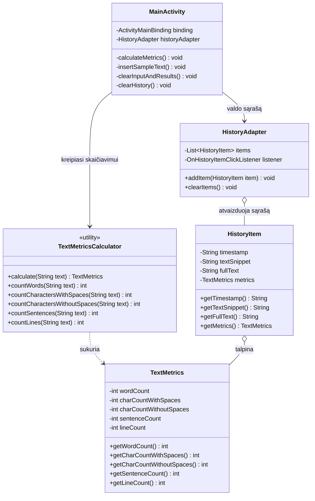

# Android programėlė: „Teksto skaičiuoklė“

Android programėlė sukurta naudojant **Java** programavimo kalbą ir **klasikinius Android XML Views** su **ViewBinding** bei **Material Design 3**.

---

## 🎯 Užduoties reikalavimų įgyvendinimas

| Reikalavimas | Realizacija programėlėje | Failas / Vieta |
| :--- | :--- | :--- |
| **Atskiras perpanaudojamas modulis** | Skaičiavimai atliekami grynoje Java paslaugų klasėje be Android priklausomybių. Pilnai paruošta perpanaudojimui kituose projektuose ar JUnit testuose. | [`TextMetricsCalculator.java`](file:///C:/Users/EzaZenkai/AndroidStudioProjects/TekstoSkaiciuokle/app/src/main/java/lt/teksto/skaiciuokle/calculator/TextMetricsCalculator.java) |
| **Įvesties lauko tikrinimas (validacija)** | Tikrinama, ar tekstas nėra tuščias ar sudarytas tik iš tarpų. Jei tuščias – parodoma klaida `TextInputLayout` lauke ir išvedamas `Toast` pranešimas. | [`MainActivity.java`](file:///C:/Users/EzaZenkai/AndroidStudioProjects/TekstoSkaiciuokle/app/src/main/java/lt/teksto/skaiciuokle/MainActivity.java#L85-L95) |
| **Lengvai lokalizuojami grafiniai tekstai** | Nei viena eilutė nėra įkoduota tiesiogiai į kodą ar maketą (zero hardcoded strings). Visi tekstai iškelti į XML resursus su lietuvišku ir anglišku vertimu. | [`strings.xml (LT)`](file:///C:/Users/EzaZenkai/AndroidStudioProjects/TekstoSkaiciuokle/app/src/main/res/values/strings.xml)<br>[`strings.xml (EN)`](file:///C:/Users/EzaZenkai/AndroidStudioProjects/TekstoSkaiciuokle/app/src/main/res/values-en/strings.xml) |
| **Atliktų skaičiavimų istorija (runtime)** | Kiekvienas atliktas skaičiavimas išsaugomas į sąrašą su laiko žyma, teksto iškarpa ir santrauka. Atvaizduojama `RecyclerView` sąraše ekrano apačioje. Spustelėjus įrašą, tekstas atkuriamas įvedimo lauke. | [`HistoryAdapter.java`](file:///C:/Users/EzaZenkai/AndroidStudioProjects/TekstoSkaiciuokle/app/src/main/java/lt/teksto/skaiciuokle/adapter/HistoryAdapter.java) |
| **Testavimo sakinių generavimas** | Mygtukas „Pavyzdinis tekstas“ įkelia paruoštą turtingą tekstą su lietuviškomis raidėmis, skaičiais, skyrybos ženklais ir pastraipomis. | [`activity_main.xml`](file:///C:/Users/EzaZenkai/AndroidStudioProjects/TekstoSkaiciuokle/app/src/main/res/layout/activity_main.xml#L65-L77) |
| **Teksto ir rezultatų išvalymas** | Mygtukas „Išvalyti“ išvalo įvesties lauką, nuima validacijos klaidą ir atstato rezultatų skaitiklius į pradinę būseną. | [`MainActivity.java`](file:///C:/Users/EzaZenkai/AndroidStudioProjects/TekstoSkaiciuokle/app/src/main/java/lt/teksto/skaiciuokle/MainActivity.java#L125-L135) |
| **Automatiniai vienetų testai** | Parašyti JUnit testai, tikrinantys null reikšmes, tarpus, žodžių, sakinių, simbolių ir eilučių skaičiavimą su lietuviškomis raidėmis. | [`TextMetricsCalculatorTest.java`](file:///C:/Users/EzaZenkai/AndroidStudioProjects/TekstoSkaiciuokle/app/src/test/java/lt/teksto/skaiciuokle/TextMetricsCalculatorTest.java) |

---

## 🏗️ Architektūra ir klasių struktūra



---

## 📁 Projekto failų hierarchija

Projektas paruoštas dviejose vietose:
- Pagrindinė Android Studio projektų vieta: `C:\Users\EzaZenkai\AndroidStudioProjects\TekstoSkaiciuokle`
- Darbinis scratch aplankas: `C:\Users\EzaZenkai\.gemini\antigravity\scratch\TekstoSkaiciuokle`

```text
TekstoSkaiciuokle/
├── app/
│   ├── build.gradle.kts
│   └── src/
│       ├── main/
│       │   ├── AndroidManifest.xml
│       │   ├── java/lt/teksto/skaiciuokle/
│       │   │   ├── MainActivity.java
│       │   │   ├── adapter/
│       │   │   │   └── HistoryAdapter.java
│       │   │   ├── calculator/
│       │   │   │   └── TextMetricsCalculator.java   <-- Reusable logika
│       │   │   └── model/
│       │   │       ├── HistoryItem.java
│       │   │       └── TextMetrics.java
│       │   └── res/
│       │       ├── layout/
│       │       │   ├── activity_main.xml
│       │       │   └── item_history.xml
│       │       ├── values/
│       │       │   ├── colors.xml
│       │       │   ├── strings.xml                  <-- LT lokalizacija
│       │       │   └── themes.xml
│       │       └── values-en/
│       │           └── strings.xml                  <-- EN lokalizacija
│       └── test/java/lt/teksto/skaiciuokle/
│           └── TextMetricsCalculatorTest.java       <-- JUnit testai
├── build.gradle.kts
├── settings.gradle.kts
└── gradlew.bat
```

---

## 🚀 Kaip paleisti projektą Android Studio

1. Paleiskite **Android Studio**.
2. Pasirinkite **File ➔ Open...**.
3. Pasirinkite aplanką:
   `C:\Users\EzaZenkai\AndroidStudioProjects\TekstoSkaiciuokle`
4. Sulaukite, kol Gradle atliks sinchronizaciją (visi Gradle failai ir wrapperiai jau paruošti).
5. Paleiskite programėlę emuliatoriuje arba prijungtame telefone spustelėję žalią **Run (Shift + F10)** mygtuką.
6. JUnit testus galite paleisti paspaudę dešiniuoju pelės mygtuku ant [`TextMetricsCalculatorTest.java`](file:///C:/Users/EzaZenkai/AndroidStudioProjects/TekstoSkaiciuokle/app/src/test/java/lt/teksto/skaiciuokle/TextMetricsCalculatorTest.java) ➔ **Run 'TextMetricsCalculatorTest'** (arba terminale su `.\gradlew test`).
