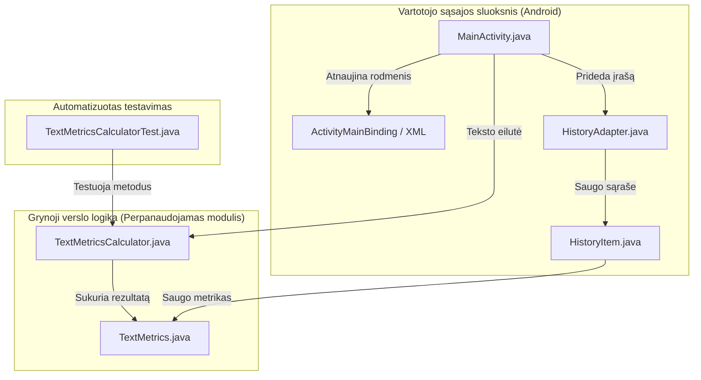

# 📱 Teksto skaičiuoklė (Android Text Metrics Calculator)

[](https://developer.android.com)
[](https://www.java.com)
[](https://developer.android.com/topic/libraries/view-binding)
[](https://m3.material.io)
[-lightgrey.svg)](https://developer.android.com)
[-brightgreen.svg)](https://developer.android.com)
[-success.svg)](https://junit.org)

Moderni, modulinė ir patogi **Android** programėlė, skirta analizuoti ir skaičiuoti įvairiapuses įvesto teksto metrikas. Programėlė sukurta naudojant **Java 11**, **Android XML Views** su **ViewBinding**, **Google Material Design 3** komponentus bei atitinka aukščiausius kodo kokybės, perpanaudojamumo ir architektūros reikalavimus.

---

## 📑 Turinys
- [Paskirtis ir Savybės](#-paskirtis-ir-pagrindinės-savybės)
- [Užduoties reikalavimų įgyvendinimas](#-užduoties-reikalavimų-įgyvendinimas)
- [Vartotojo vadovas (Kaip naudotis)](#-vartotojo-vadovas-kaip-naudotis)
- [Architektūra ir moduliai](#-architektūra-ir-moduliai)
- [Projekto struktūra](#-projekto-struktūra)
- [Daugiakalbystė (Lokalizacija)](#-daugiakalbystė-lokalizacija--i18n)
- [Automatiniai testai](#-automatiniai-testai-junit)
- [Kaip paleisti ir išbandyti](#-kaip-paleisti-ir-išbandyti)
- [Technologijų stekas](#-technologijų-stekas)

---

## 🎯 Paskirtis ir pagrindinės savybės

„Teksto skaičiuoklė“ leidžia akimirksniu išanalizuoti bet kokį tekstą – nuo paprasto sakinio iki ilgo straipsnio ar pastraipų:

1. **Tikslus metrikų skaičiavimas**:
   - ✍️ **Žodžių skaičius**: atpažįsta žodžius pagal Unicode raides (`\p{L}`), teisingai apdoroja lietuviškus rašmenis (`ą, č, ę, ė, į, š, ų, ū, ž`). Pavieniai skaičiai ar skyrybos ženklai nėra klaidingai laikomi žodžiais.
   - 🔢 **Skaičių kiekis**: atskirai suskaičiuoja tekste esančius skaičius ir skaitmeninius fragmentus (pvz., *„15“*, *„2026“*, *„3.14“*).
   - 📖 **Sakinių skaičius**: analizuoja sakinius pagal pabaigos skyrybos ženklus (`.`, `!`, `?`, `…`), atskirtus tarpais ar eilučių lūžiais, taip pat teisingai traktuoja nebaigtus sakinius.
   - 🔤 **Rašybos ženklai (su tarpais)**: bendras visų simbolių kiekis.
   - ✂️ **Simboliai (be tarpų)**: grynas simbolių kiekis atmetus visus tarpo, tabuliacijos ir naujos eilutės simbolius.
   - 📄 **Eilučių skaičius**: pastraipų / eilučių kiekis tekste.

2. **Įvesties tikrinimas (Validacija)**:
   - Neleidžiama atlikti skaičiavimo, jei įvesties laukas yra tuščias arba sudarytas tik iš tarpų.
   - Vartotojas vaizdžiai informuojamas klaidos pranešimu `TextInputLayout` laukelyje ir iškylančia `Toast` žinute.
   - Pradėjus rašyti tekstą, klaidos indikacija automatiškai pašalinama.

3. **Pavyzdinio teksto generavimas**:
   - Mygtukas **„Pavyzdinis tekstas“** leidžia greitai išbandyti programėlę be rankinio teksto vedimo.
   - Rotuoja 4 skirtingo pobūdžio testinius sakinius: nuo trumpos frazės iki turtingo rišlaus teksto su lietuviškomis raidėmis, skaičiais ir pastraipomis.

4. **Greitas išvalymas**:
   - Mygtukas **„Išvalyti“** vienu paspaudimu išvalo įvesties lauką, nuima klaidos būseną ir atstato visų metrikų skaitiklius į pradinę būseną (`0`).

5. **Atliktų skaičiavimų istorija (Runtime)**:
   - Visi atlikti skaičiavimai realiu laiku išsaugomi `RecyclerView` sąraše ekrano apačioje su tikslia laiko žyma (`HH:mm:ss`), teksto iškarpa bei glausta santrauka.
   - **Interaktyvus atkūrimas**: spustelėjus bet kurį istorijos įrašą, buvęs tekstas akimirksniu atkuriamas įvedimo laukelyje tolesnei peržiūrai ar redagavimui.
   - Galimybė bet kada išvalyti istoriją mygtuku **„Išvalyti istoriją“**.
   - Istorija išlieka pasukus įrenginio ekraną (`onSaveInstanceState`).

6. **Pilna lokalizacija (i18n)**:
   - Vartotojo sąsaja paruošta kelioms kalboms: **lietuvių** (numatytoji) ir **anglų**.
   - Kodo ir maketų failuose nėra jokių „hardcoded“ eilučių – visi tekstai apibrėžti Android XML resursuose.

---

## 🏆 Užduoties reikalavimų įgyvendinimas

| Reikalavimas | Realizacija programėlėje | Atsakingas komponentas |
| :--- | :--- | :--- |
| **Atskiras perpanaudojamas modulis** | Skaičiavimai atliekami atskiroje grynoje Java paslaugų klasėje, neturinčioje jokių `android.*` priklausomybių. Modulį galima tiesiogiai integruoti į bet kurį backend, CLI ar Android projektą. | [`TextMetricsCalculator.java`](app/src/main/java/lt/teksto/skaiciuokle/calculator/TextMetricsCalculator.java) |
| **Įvesties lauko tikrinimas (validacija)** | Prieš skaičiuojant tikrinama, ar laukas nėra tuščias ar sudarytas tik iš tarpų. Jei tuščias – parodomas klaidos pranešimas `TextInputLayout` ir `Toast`. | [`MainActivity.java`](app/src/main/java/lt/teksto/skaiciuokle/MainActivity.java) |
| **Lokalizuojami grafiniai tekstai** | Visi tekstai iškelti į XML išteklius (`strings.xml`). Sukurtos atskiros lokalizacijos lietuvių ir anglų kalboms. | `values/strings.xml`<br>`values-en/strings.xml` |
| **Skaičiavimų istorija (runtime)** | Kiekviena atlikta operacija įrašoma į dinaminį sąrašą su laiko žyma, teksto pradžia ir metrikų santrauka. Atvaizduojama `RecyclerView` sąraše. Spustelėjus įrašą, tekstas atkuriamas. | [`HistoryAdapter.java`](app/src/main/java/lt/teksto/skaiciuokle/adapter/HistoryAdapter.java) |
| **Testavimo sakinių generavimas** | Sukurtas mygtukas „Pavyzdinis tekstas“, rotuojantis 4 skirtingus pavyzdžius. | `MainActivity.java` |
| **Teksto ir rezultatų išvalymas** | Mygtukas „Išvalyti“ išvalo įvestį, panaikina klaidos pranešimus ir anuliuoja metrikas. | `MainActivity.java` |
| **Automatiniai vienetų testai** | Parašyti išsamūs JUnit testai, tikrinantys įvairius ribinius atvejus (tuščias tekstas, tarpai, lietuviški diakritikai, skaičiai, sakiniai). | [`TextMetricsCalculatorTest.java`](app/src/test/java/lt/teksto/skaiciuokle/TextMetricsCalculatorTest.java) |

---

## 📖 Vartotojo vadovas (Kaip naudotis)

```
+-----------------------------------------------------------+
|                   Teksto skaičiuoklė                     |
+-----------------------------------------------------------+
| [ Teksto įvesties laukas ............................... ] |
| [ Čia rašykite arba įklijuokite norimą tekstą...        ] |
+-----------------------------------------------------------+
|  [ SKAIČIUOTI ]    [ PAVYZDINIS TEKSTAS ]    [ IŠVALYTI ] |
+-----------------------------------------------------------+
|  📊 Teksto metrikos                                       |
|  Žodžiai: 12        Sakiniai: 2         Skaičiai: 1       |
|  Simboliai: 75      Su tarpais: 88      Eilutės: 1        |
+-----------------------------------------------------------+
|  🕒 Skaičiavimų istorija (runtime)     [ Išvalyti istoriją ]|
|  ┌─────────────────────────────────────────────────────┐  |
|  │ 14:25:10 - Lietuvos gamta yra nuostabi...           │  |
|  │ Sakiniai: 3 | Žodžiai: 28 | Rašybos ženklai: 180    │  |
|  └─────────────────────────────────────────────────────┘  |
+-----------------------------------------------------------+
```

### 1 žingsnis: Teksto pateikimas
- **Rankinis įvedimas**: paspauskite ant laukelio **„Teksto įvestis“** ir įrašykite arba įklijuokite norimą analizuoti tekstą.
- **Pavyzdžio įkėlimas**: spustelėkite mygtuką **„Pavyzdinis tekstas“**. Programėlė automatiškai įkels demonstracinį sakinį ar pastraipą. Kaskart paspaudus mygtuką, parodomas vis kitas testinis pavyzdys.

### 2 žingsnis: Skaičiavimo atlikimas
- Paspauskite mygtuką **„Skaičiuoti“**.
- **Jei laukelis tuščias**: programėlė paryškins laukelį raudonai su pranešimu *„Įvesties laukas negali būti tuščias!“* bei parodys informacinį `Toast` pranešimą.
- **Jei laukelis užpildytas**: sekcijoje **„Teksto metrikos“** akimirksniu atsinaujins 6 rodikliai:
  - *Žodžiai*
  - *Sakiniai*
  - *Skaičiai*
  - *Simboliai (be tarpų)*
  - *Rašybos ženklai (su tarpais)*
  - *Eilutės*

### 3 žingsnis: Darbas su skaičiavimų istorija
- Atliktas skaičiavimas automatiškai patalpinamas sąrašo **„Skaičiavimų istorija (runtime)“** viršuje.
- Kiekvienoje kortelėje matysite skaičiavimo laiką, teksto pradžią ir trumpą santrauką.
- **Teksto atkūrimas**: spustelėkite bet kurią istorijos kortelę – joje buvęs pilnas tekstas bus automatiškai įkeltas atgal į įvesties laukelį.
- **Istorijos valymas**: paspauskite mygtuką **„Išvalyti istoriją“**, jei norite pašalinti visus ankstesnius įrašus.

### 4 žingsnis: Naujo teksto analizė
- Paspauskite mygtuką **„Išvalyti“** – įvesties tekstas bus pašalintas, o metrikų reikšmės atstatytos į `0`.

---

## 🏛️ Architektūra ir moduliai

Projektas suprojektuotas laikantis **atsakomybių atskyrimo (Separation of Concerns)** principo:



### 1. Reusable skaičiuoklės modulis (`lt.teksto.skaiciuokle.calculator`)
- **`TextMetricsCalculator`**:
  - Gryna Java paslaugų klasė (utility class) su privačiu konstruktoriumi ir statiniais metodais.
  - Visiškai nepriklauso nuo Android SDK (`android.*`).
  - Gali būti eksportuojama kaip atskiras `.jar` failas ir naudojama bet kuriame kitame projekte.
  - Naudoja sukompiliuotus `java.util.regex.Pattern` šablonus maksimaliam našumui pasiekti.

### 2. Duomenų modeliai (`lt.teksto.skaiciuokle.model`)
- **`TextMetrics`**: nekintantis (immutable) duomenų objektas, saugantis apskaičiuotas metrikų reikšmes.
- **`HistoryItem`**: istorijos įrašo modelis, saugantis laiko žymą, apkarpytą iškarpą (snippet), pilną tekstą ir atitinkamas metrikas (`Serializable` palaikymas ekrano pasukimui).

### 3. Vartotojo sąsaja (`lt.teksto.skaiciuokle`)
- **`MainActivity`**: valdo vartotojo veiksmus, mygtukų paspaudimus, validaciją ir būsenos atkūrimą.
- **`HistoryAdapter`**: `RecyclerView.Adapter` realizacija efektyviam sąrašo atvaizdavimui.

---

## 📁 Projekto struktūra

```text
TekstoSkaiciuokle/
├── .gitignore
├── build.gradle.kts                      # Šakninis Gradle konfigūracijos failas
├── settings.gradle.kts                   # Projekto moduliai ir repozitorijos
├── gradlew / gradlew.bat                 # Gradle paleidimo wrapperiai
├── README.md                             # Ši dokumentacija
├── PROJECT_REPORT.md                     # Išsami akademinė ataskaita
│
└── app/
    ├── build.gradle.kts                  # Programėlės priklausomybės ir SDK nustatymai
    └── src/
        ├── test/java/lt/teksto/skaiciuokle/
        │   └── TextMetricsCalculatorTest.java   # 🧪 JUnit testai skaičiuoklės moduliui
        │
        └── main/
            ├── AndroidManifest.xml              # Programėlės manifestas
            ├── java/lt/teksto/skaiciuokle/
            │   ├── MainActivity.java            # Pagrindinis langas ir validacija
            │   ├── adapter/
            │   │   └── HistoryAdapter.java      # Istorijos sąrašo adapteris
            │   ├── calculator/
            │   │   └── TextMetricsCalculator.java # ⚙️ Perpanaudojamas skaičiavimų modulis
            │   └── model/
            │       ├── HistoryItem.java         # Istorijos įrašo modelis
            │       └── TextMetrics.java         # Metrikų duomenų modelis
            │
            └── res/
                ├── layout/
                │   ├── activity_main.xml        # Pagrindinio ekrano maketas
                │   └── item_history.xml         # Istorijos elemento kortelės maketas
                ├── values/
                │   ├── colors.xml               # Spalvų paletė
                │   ├── strings.xml              # 🇱🇹 Lietuviški tekstai (pagrindinė lokalizacija)
                │   └── themes.xml               # Material 3 temos
                └── values-en/
                    └── strings.xml              # 🇬🇧 Angliški tekstai (anglų k. lokalizacija)
```

---

## 🌐 Daugiakalbystė (Lokalizacija / i18n)

Programėlė palaiko automatinį kalbos parinkimą pagal įrenginio sistemos nustatymus:
- Jei įrenginio kalba yra **lietuvių**, naudojami resursai iš `values/strings.xml`.
- Jei įrenginio kalba yra **anglų** (arba bet kuri kita), naudojami resursai iš `values-en/strings.xml`.

Visos vartotojui rodomos žinutės, etiketės, mygtukai, `Toast` pranešimai ir pavyzdiniai tekstai yra iškelti į XML resursus.

---

## 🧪 Automatiniai testai (JUnit 4 + Mockito + Espresso)

Projekte realizuoti dviejų lygių automatiniai testai pagal akademinius reikalavimus:

### 1. Vienetų („Unit“) testai (100% klasių ir funkcijų aprėptis)
Vykdomi JVM lygmenyje greitai ir be emuliatoriaus (`app/src/test/java/`):

- **[`TextMetricsCalculatorTest.java`](app/src/test/java/lt/teksto/skaiciuokle/TextMetricsCalculatorTest.java)**: tikrina `TextMetricsCalculator` skaičiavimo logiką, žodžių, skaičių, sakinių, eilučių atskyrimą, Unicode/lietuviškus diakritikus, privačius konstruktorius per refleksiją (100% kodo aprėptis).
- **[`TextMetricsTest.java`](app/src/test/java/lt/teksto/skaiciuokle/model/TextMetricsTest.java)**: tikrina `TextMetrics` duomenų modelį, konstruktorius, geterius, `equals`, `hashCode` ir `toString` metodus (100% aprėptis).
- **[`HistoryItemTest.java`](app/src/test/java/lt/teksto/skaiciuokle/model/HistoryItemTest.java)**: tikrina `HistoryItem` trumpo ir ilgo teksto (>60 simbolių su „…“) iškarpas, `null` reikšmių apsaugą (100% aprėptis).
- **[`HistoryAdapterTest.java`](app/src/test/java/lt/teksto/skaiciuokle/adapter/HistoryAdapterTest.java)**: tikrina `HistoryAdapter` ir `HistoryViewHolder` (30 elementų limito valdymą, sąrašo išvalymą, elementų įrišimą, ViewHolder paspaudimų klausytojus naudojant `Mockito`) (100% aprėptis).

#### JaCoCo kodo padengimo (Coverage) rezultatai:
- `lt.teksto.skaiciuokle.calculator`: **100% klasių, 100% metodų (9/9), 100% eilučių, 100% šakų**
- `lt.teksto.skaiciuokle.model`: **100% klasių, 100% metodų (17/17), 100% eilučių, 100% šakų**
- `lt.teksto.skaiciuokle.adapter`: **100% klasių, 100% metodų (11/11), 100% eilučių, 100% šakų**

Paleidimas terminale:
```powershell
.\gradlew testDebugUnitTest
.\gradlew createDebugUnitTestCoverageReport
```

---

### 2. UI / Integraciniai testai (Espresso – 4 scenarijai)
Tikrina grafinės vartotojo sąsajos veikimą realiame įrenginyje arba emuliatoriuje (`app/src/androidTest/java/`):

- **[`MainActivityEspressoTest.java`](app/src/androidTest/java/lt/teksto/skaiciuokle/MainActivityEspressoTest.java)**:
  - **Scenarijus 1 (Įvesties validacija)**: tuščio teksto ar tik tarpų įvedimas -> patikrinama, kad skaitikliai lieka 0 ir neleidžiama atlikti skaičiavimo.
  - **Scenarijus 2 (Skaičiavimas ir rezultatų atvaizdavimas)**: įvedamas sakinys su žodžiais ir skaičiais -> patikrinamos visos 6 rezultatų kortelės ekrane.
  - **Scenarijus 3 (Pavyzdžių generavimas ir rotacija)**: paspaudžiamas pavyzdžių mygtukas kelis kartus -> patikrinamas pavyzdžių įkėlimas ir rotacija.
  - **Scenarijus 4 (Istorija, atstatymas ir išvalymas)**: atlikus skaičiavimą atsiranda kortelė, paspaudus „Išvalyti“ viskas nunulinama, paspaudus ant kortelės tekstas atkuriamas, o paspaudus „Išvalyti istoriją“ sąrašas išvalomas.

Paleidimas terminale (su prijungtu įrenginiu / emuliatoriumi):
```powershell
.\gradlew connectedAndroidTest
```

---

## 🚀 Kaip paleisti ir išbandyti

### Reikalavimai
- **Android Studio** (Koala, Ladybug, Iguana ar naujesnė).
- **Android SDK**: `minSdk 26` (Android 8.0 Oreo), `compileSdk / targetSdk 35`.
- **JDK**: Java 11, 17 arba 21 (Android Studio įmontuotas JBR pilnai tinka).

### Paleidimas per Android Studio
1. Atsisiųskite arba nusiklonuokite šią repozitoriją:
   ```bash
   git clone https://github.com/EzaZenkai/text-app.git
   ```
2. Paleiskite **Android Studio**.
3. Pasirinkite **File ➔ Open...** ir nurodykite projekto aplanką (`TekstoSkaiciuokle`).
4. Palaukite, kol Gradle atliks projekto sinchronizaciją (*Sync Project with Gradle Files*).
5. Pasirinkite norimą emuliatorių arba prijunkite fizinį Android įrenginį per USB.
6. Paspauskite žalią mygtuką **Run (Shift + F10)**.

### Kompiliavimas per terminalą
- **Sukurti Debug APK**:
  ```powershell
  .\gradlew assembleDebug
  ```
  Sukurtas failas bus patalpintas: `app/build/outputs/apk/debug/app-debug.apk`
- **Paleisti testus**:
  ```powershell
  .\gradlew test
  ```

---

## 🛠️ Technologijų stekas

- **Programavimo kalba**: [Java 11](https://www.oracle.com/java/)
- **Vartotojo sąsaja**: Android XML Layouts, ViewBinding
- **Dizaino sistema**: Google [Material Design 3](https://m3.material.io/) (`com.google.android.material`)
- **Sąrašai**: `androidx.recyclerview:recyclerview:1.4.0`
- **Kompiliavimo sistema**: Gradle su Kotlin DSL (`build.gradle.kts`)
- **Testavimo karkasas**: [JUnit 4](https://junit.org/junit4/)

---

## 👤 Autorius
Sukūrė: **EzaZenkai**  
Projektas paruoštas demonstraciniams, mokymosi ir praktiniams tikslams.
